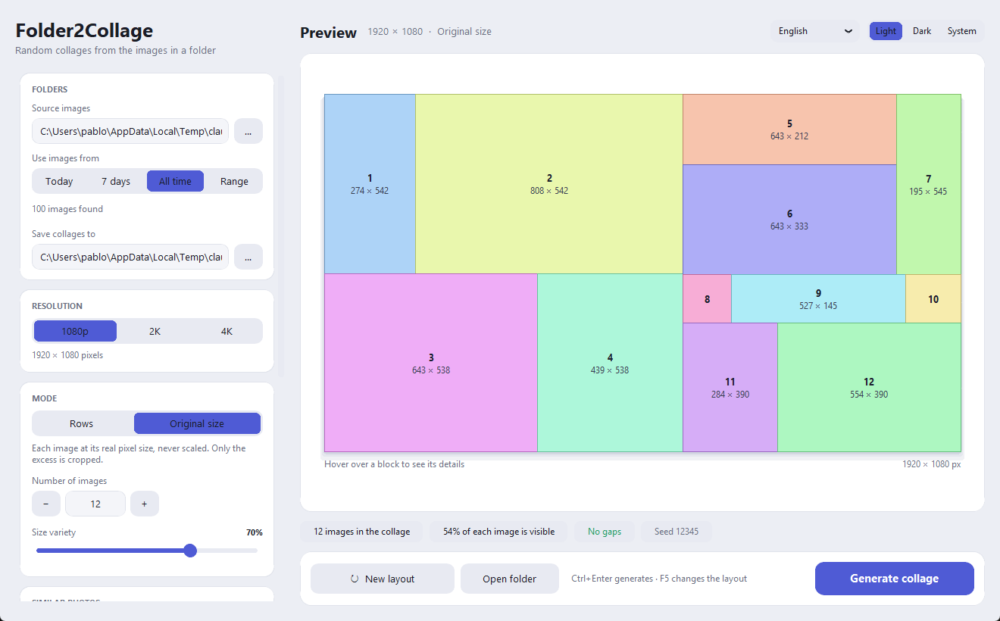

# Folder2Collage

[English](README.md) · [Español](README.es.md) · [Deutsch](README.de.md) · [Français](README.fr.md) · [Italiano](README.it.md) · **Português**

Crie colagens aleatórias com as imagens de uma pasta — por exemplo suas capturas de
tela do Windows. Escolha uma resolução, um modo e quantas imagens, e o Folder2Collage
as organiza em uma colagem. Tudo é executado no seu PC; **nunca é enviado nada pela
internet.**

*O app está em inglês, espanhol, alemão, francês, italiano e português, e detecta o
idioma do seu Windows — você pode trocá-lo quando quiser.*



## Recursos

- **Dois modos:** *Linhas* (as imagens são redimensionadas e cortadas um pouco para
  preencher linhas) e *Tamanho original* (cada imagem no seu tamanho real em pixels, sem
  redimensionar — só se corta o que sobra).
- **Pré-visualização ao vivo** da disposição exata antes de gerar, com blocos coloridos,
  para que o conteúdo das suas imagens só apareça quando você decidir gerar.
- **Filtro por data:** hoje, últimos 7 dias, sempre ou um intervalo personalizado.
- **Fotos parecidas (opcional, IA local):** agrupe paisagens, rostos, animais, texto…
  por conteúdo, ou pesquise por texto — com um modelo CLIP que roda no seu PC.
- **Resoluções** até 4K, espaçamento ajustável, cor de fundo, marca d'água com o nome,
  sementes para reproduzir uma colagem e geração em lote.

## Privacidade

O Folder2Collage mantém suas imagens privadas. Sem análise, sem telemetria, sem contas.
Suas capturas, colagens e pesquisas nunca saem do seu computador. A única conexão com a
internet é o download opcional e único do modelo de IA, e mesmo assim suas imagens nunca
são enviadas. Veja [PRIVACIDAD.md](PRIVACIDAD.md) para a declaração completa em seis
idiomas.

## Instalação (Windows)

1. Baixe `Folder2Collage-x.y.z-Setup.exe` na página de
   [Releases](https://github.com/CementoESP/Folder2Collage/releases).
2. Execute-o. Ele é instalado para o usuário atual e não precisa de direitos de
   administrador.

O Folder2Collage não é assinado digitalmente, então o Windows SmartScreen pode mostrar
"O Windows protegeu o seu PC" na primeira vez. Clique em **Mais informações → Executar
mesmo assim**.

## IA opcional (fotos parecidas)

O recurso "fotos parecidas" usa um modelo CLIP local. O modelo **não** vem com o
instalador: na primeira vez que você ativa o recurso, o app pede permissão para baixá-lo
(cerca de 130 MB, uma única vez). Depois disso, funciona totalmente offline. Você também
pode pré-instalá-lo sem abrir a janela:

```
Folder2Collage.exe --descargar-ia
```

## Compilar a partir do código

Requer Python 3.12+ no Windows.

```
python -m venv .venv
.venv\Scripts\python -m pip install -r empaquetado\requirements-build.txt
.venv\Scripts\python empaquetado\construir.py
```

Isso produz o app em `empaquetado\dist\Folder2Collage\` e o instalador em
`empaquetado\salida\`. Para compilar o instalador também é necessário o
[Inno Setup 6](https://jrsoftware.org/isinfo.php)
(`winget install JRSoftware.InnoSetup`).

Para executá-lo diretamente sem compilar, instale as dependências de execução de
`requirements.txt` e abra `Folder2Collage.pyw`.

## Licença

Veja [LICENSE](LICENSE). Os componentes de terceiros e suas licenças estão listados em
[AVISOS_TERCEROS.txt](AVISOS_TERCEROS.txt).

---

Feito por CementoESP.
